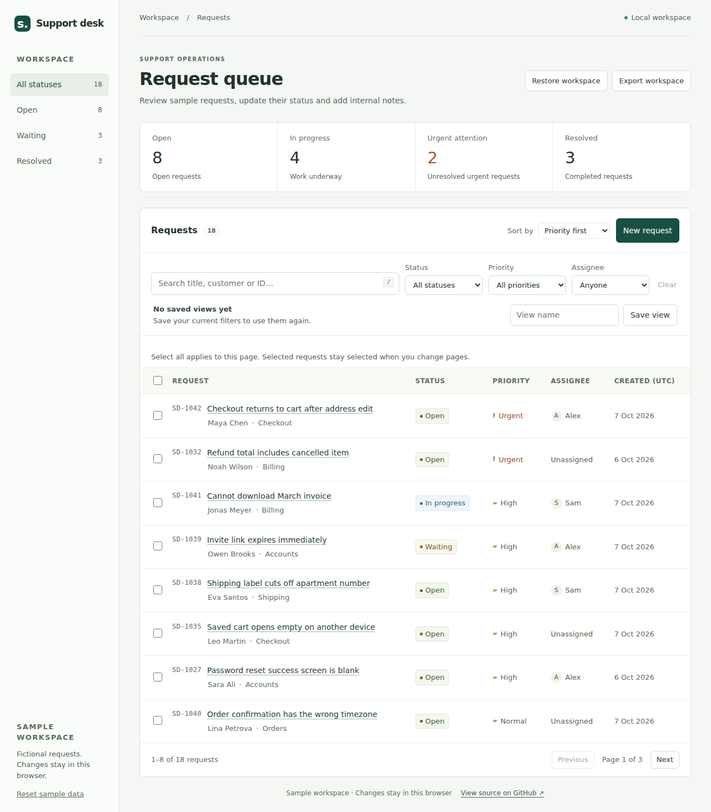

# Support Desk Workbench

A support queue for creating and triaging requests, recording internal notes and keeping work between visits. Built with React, TypeScript and Vite; an optional local Node.js server adds SQLite snapshots. The create-request flow uses scoped Tailwind CSS utilities without Preflight.

[Live demo](https://flankero-dev.github.io/support-desk-workbench/) · [Checks](https://github.com/flankero-dev/support-desk-workbench/actions/workflows/checks.yml) · [Engineering decisions](docs/decisions.md)

The demo uses fictional customers and browser storage. It opens directly into a working queue.



## Review it in two minutes

Choose **New request** in the queue. Submit an empty form to see field errors, then enter a title, customer, category and description. New requests start as Open, with Normal priority and no assignee. Success appears only after browser storage accepts the write. Current filters and sorting stay intact; the confirmation explains if they hide the new request and offers **View request**.

1. Search for **Maya** and open the checkout request. Change its status, add a note, then close it with **Escape**.
2. Reload. The URL restores the search; the edited request and note remain saved.
3. Clear the search, select **Open** and **Urgent**, name the filters and choose **Save view**. Clear the filters and reapply that view.
4. Select a few visible requests and apply a new status. The selection count and queue update together.
5. Export a backup, reset the sample data, then import the backup to restore the edited workspace.

On narrow screens the table scrolls within the queue. Sidebar status filters preserve other filters.

## Code worth reviewing

| Decision                                        | Implementation                                                               | Evidence                                                                                             |
| ----------------------------------------------- | ---------------------------------------------------------------------------- | ---------------------------------------------------------------------------------------------------- |
| Keep filtering and updates independent of React | [Ticket domain](src/domain/tickets.ts)                                       | [Composed filters, URL round trips, immutable updates and import validation](tests/tickets.test.mjs) |
| Preserve the complete view in a bookmark        | [Queue state](src/App.tsx), [saved views](src/domain/views.ts)               | [Duplicate views and validation](tests/views.test.mjs)                                               |
| Protect stored edits when another tab writes    | [Workspace persistence](src/useWorkspace.ts)                                 | [Two-tab conflict and blocked-storage scenarios](tests/browser-smoke.mjs)                            |
| Validate a replacement before applying it       | [Import dialog](src/components/ImportDialog.tsx)                             | Invalid JSON leaves the current workspace intact                                                     |
| Provide a real optional HTTP/SQL boundary       | [Loopback server](server/app.ts), [relational storage](server/storage.ts)    | [Migration, restart, concurrent writes and rollback](tests/server-api.test.mjs)                      |
| Preserve keyboard navigation after editing      | [Ticket dialog](src/components/TicketDialog.tsx), [queue state](src/App.tsx) | Escape, focus restoration and filtered-out requests in browser smoke                                 |

The regression suite includes long imported names, an assignee literally named `All`, histories exceeding 500 entries and an attempted edit at the JSON size limit. These are examples of data-contract and interaction failures found during browser review.

## Run locally

Use Node.js 24 and npm.

```sh
npm ci
npm run dev
```

To run the built application with the optional SQLite snapshot API:

```sh
npm run build
npm run start
# http://127.0.0.1:3000
```

Server snapshot is enabled after the local API responds with a valid JSON revision. Vite development and preview servers leave it disabled; the public demo hides it.

Choose **Server snapshot → Refresh server copy** to compare the current server revision. Saving uses an ETag and `If-Match`; a stale revision returns HTTP 412. Replacing either copy is an explicit action. The database is `data/workspace.sqlite`, excluded from git.

Requests and activity entries live in related SQL tables. Saving replaces them in one transaction together with the revision. Existing JSON-based databases migrate automatically on first startup, retaining their data and revision. Back up the database before upgrading; invalid legacy data or an unsupported schema stops startup without reseeding. The old server cannot read the migrated schema.

## Verify

```sh
npm test
npm run format:check
npm run lint
npm run build
npx playwright install --with-deps chromium firefox webkit
npm run test:browser
npm run test:audit
npm run test:a11y
```

Tests use Node's built-in runner. Browser checks use the production build and cover filtering, pagination, saved views, editing, import/export, reset, keyboard focus, storage conflicts and server snapshots. CI runs these checks; the Pages deployment also checks the build before publishing. Browser screenshots are available as CI artifacts.

Create-request design and review: [design specification](docs/create-request-design.md), [QA evidence and limitations](docs/create-request-qa.md). No Figma file or Figma handoff was produced. Additional browser checks cover field validation, ID collisions, record/UTF-8 limits, failed persistence, multi-tab conflicts, responsive layout and axe accessibility scans. To reproduce the optional pre-change CSS comparison, build the base revision separately and set `BASELINE_DIST=/path/to/base/dist` when running `node tests/create-request-review.mjs`.

Audit scope, regression mapping and known verification limits: [October 2026 hardening](docs/audit/README.md). CI also runs Firefox/WebKit and Windows.

## Boundaries

- The public demo stores requests in this browser and profile. Export before clearing site data or switching browsers.
- Restore accepts an exported JSON file or pasted JSON and replaces the queue after validation. Limits: 500 requests and 2 million UTF-8 bytes, including the canonical export. Edits that would exceed this limit are rejected before changing the workspace; a rejected note remains in the input. Any accepted workspace can be exported and restored. Up to eight saved views are separate browser preferences.
- Storage conflicts pause saving in the stale tab. Export its unsaved edits if needed, then reload the saved workspace; changes are not merged automatically.
- The SQLite server binds to loopback and has one workspace. It is a local reference implementation, without user accounts or multi-tenant authorization.
- The UI appends activity entries; JSON import can replace their content. History is local data, not a tamper-proof audit trail. This project does not claim a production support integration or a certified accessibility audit.
