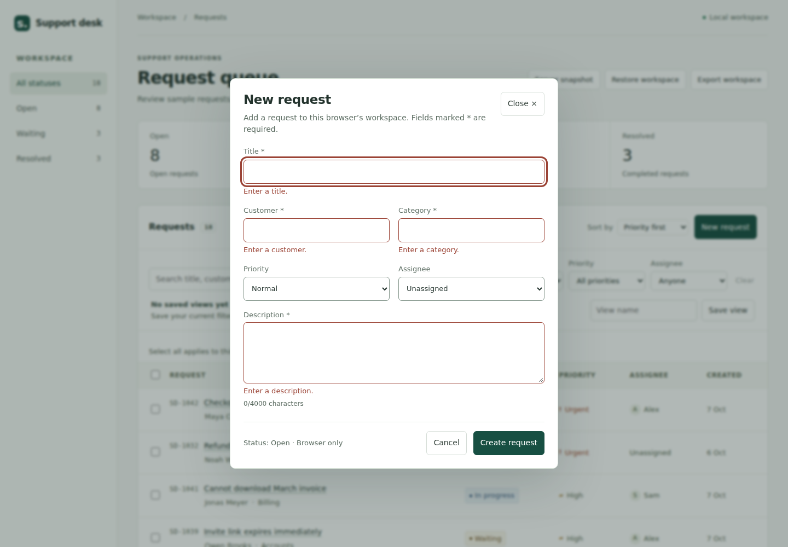
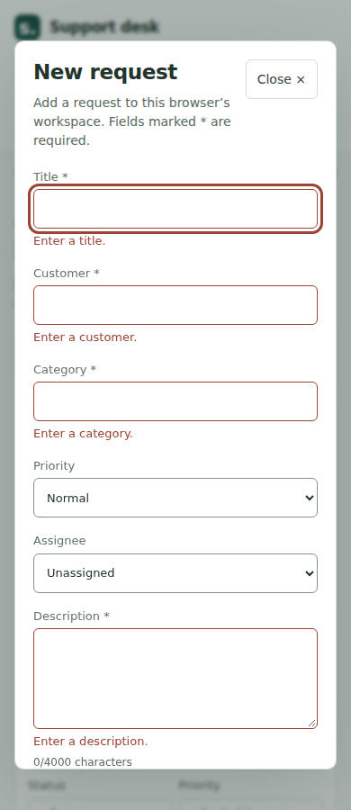
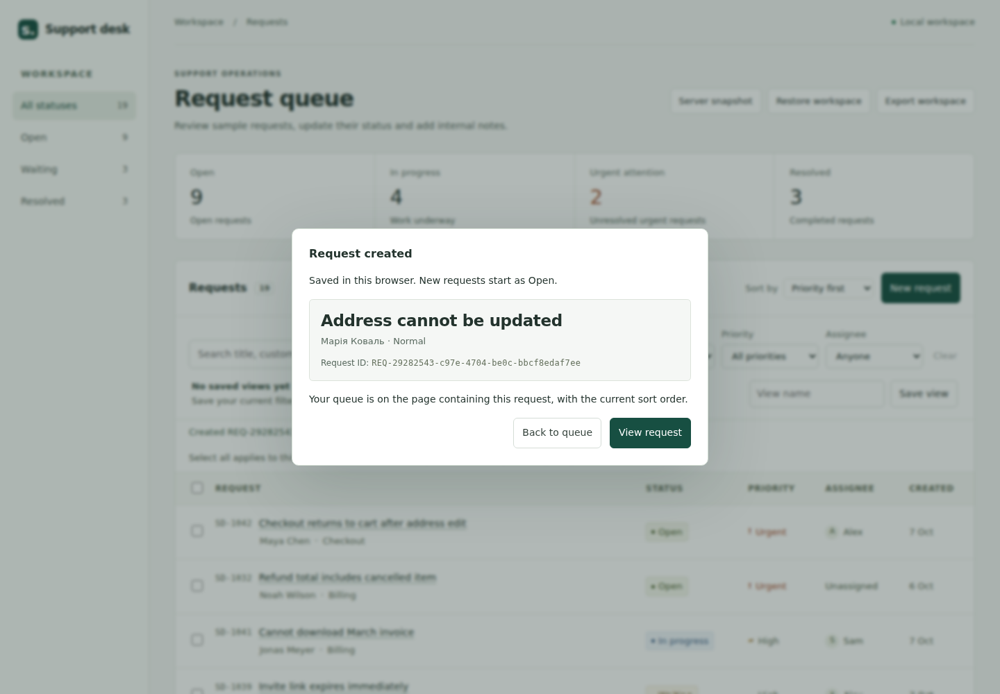
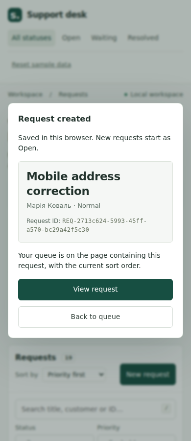

# Create request — design specification

## Design source and scope

This is a specification of the implemented scenario, derived from the existing Support Desk Workbench interface. **No Figma document was created or opened, and no Figma handoff is claimed.** No connected Figma editing/workspace capability was available. The screenshots below are actual browser captures of the production build, not a substitute presented as a Figma file.

One action is added to the queue heading: **New request**. It opens a native modal dialog. The existing queue, detail view, design language and storage model remain in use.

## Geometry and tokens

| Element          | Specification                                                                                                                                                |
| ---------------- | ------------------------------------------------------------------------------------------------------------------------------------------------------------ |
| Dialog           | Existing white surface, 1 px `#d3ded4` border, 10 px radius; width `calc(100% - 32px)`, maximum 600 px, maximum height 90 vh; vertical scrolling when needed |
| Backdrop         | Existing `#142a2355` with 2 px blur                                                                                                                          |
| Inner padding    | 20 px below 640 px viewport width; 24 px at/above 640 px                                                                                                     |
| Grid             | One column below 640 px; two equal columns at/above 640 px; 16 px gap; title/description span both columns                                                   |
| Heading          | Existing font stack; 23 px, weight 600, line-height 1.3, tracking -0.4 px                                                                                    |
| Text             | 14 px / 21 px, `#23332d`; secondary `#58695e`; labels 13 px, `#637369`                                                                                       |
| Controls         | Minimum 44 px high; existing font, 6 px radius, 8 px vertical / 10 px horizontal padding; textarea minimum 112 px, vertically resizable                      |
| Control boundary | `#82948a`, approximately 3.21:1 against white; scoped to this dialog                                                                                         |
| Invalid          | `#9b4335` border and 13 px error text; persistent label, `aria-invalid`, linked error description                                                            |
| Primary action   | Existing `.primary`: `#174f42` background with white text; existing hover/focus treatment                                                                    |
| Focus            | 3 px outline, 3 px offset: `#276752` normally, `#9b4335` on invalid fields; focused elements scroll into view                                                |
| Actions          | 12 px gap; 44 px minimum buttons. Mobile actions remain within the dialog's scrollable content                                                               |
| Footer           | 24 px top margin, 16 px top padding, existing divider color; browser-only persistence notice                                                                 |

Tailwind's spacing scale uses rem, while this application's root is 14 px. Intentional pixel values avoid accidentally turning a 44 px target into 38.5 px. The responsive boundary is verified immediately below/at 640 px.

## Fields

| Label         | Data field    | Default                                 | Validation                                                                 |
| ------------- | ------------- | --------------------------------------- | -------------------------------------------------------------------------- |
| Title *       | `title`       | Empty                                   | Non-whitespace; trimmed, 1–200 characters                                  |
| Customer *    | `customer`    | Empty                                   | Non-whitespace; trimmed, 1–200 characters                                  |
| Category *    | `category`    | Empty; suggestions from current tickets | Non-whitespace; trimmed, 1–200 characters; new categories allowed          |
| Priority      | `priority`    | Normal                                  | Existing priority enum                                                     |
| Assignee      | `assignee`    | Unassigned                              | Existing workspace options, including imported names                       |
| Description * | `description` | Empty                                   | Non-whitespace; trimmed, 1–4000 characters; internal line breaks preserved |

ID, status Open, timestamps and the initial history entry are generated, rather than additional user input. The whole candidate snapshot must still pass the existing importer, 500-record limit and 2 million UTF-8-byte limit.

## States and behavior

- **Default:** title receives initial focus; labels and required marks stay visible. Cancel, Close or Escape discard this unsubmitted draft. Reopening starts clean.
- **Invalid:** submit shows specific messages and focuses the first invalid field. Errors update as that field is corrected. Enter in a text field submits; Enter in description inserts a newline.
- **Persistence error:** the form stays open and retains all values. Failed storage, duplicate ID, capacity and another-tab conflicts produce actionable text. No success message or in-memory insert is committed for a rejected creation.
- **Success:** focus moves to the confirmation heading. The title is the primary 23 px semibold heading in the summary card; the confirmation label is 16 px. The full, selectable ID follows customer/priority as labelled 12 px secondary text. Long titles and IDs wrap without truncation. It offers View request or Back to queue. Existing filters and sort are not silently cleared; a hidden result is explained. A matching result's page is selected using its actual filtered/sorted index.
- **Loading/disabled:** no artificial loading delay or disabled-submit state is introduced. Creation is a synchronous browser-storage operation; there is no creation request to a server. Native controls and existing unrelated disabled buttons retain their behavior.
- Tab/Shift+Tab wrap within the modal; native modality keeps the background inert. Closing restores the New request trigger; View request opens the existing detail dialog.

## CSS integration

The Vite Tailwind plugin compiles `tw:`-prefixed utilities used only by App and CreateRequestDialog. Theme and utilities are imported separately; **Preflight is omitted**. Utilities are unlayered so existing unlayered element rules do not automatically outrank them. One scoped control-border rule matches the legacy `input:not([type=checkbox])` specificity. The invalid attribute utility is more specific. No global font, heading, input or button reset is added.

## Browser comparison

Measured widths, column counts, target heights and overflow checks are recorded in [browser results](create-request/browser-results.json). On small screens, the 90 vh dialog intentionally scrolls vertically; screenshots of invalid fields can therefore show the focused field instead of the header. This is not a claim that the full form fits without scrolling.
