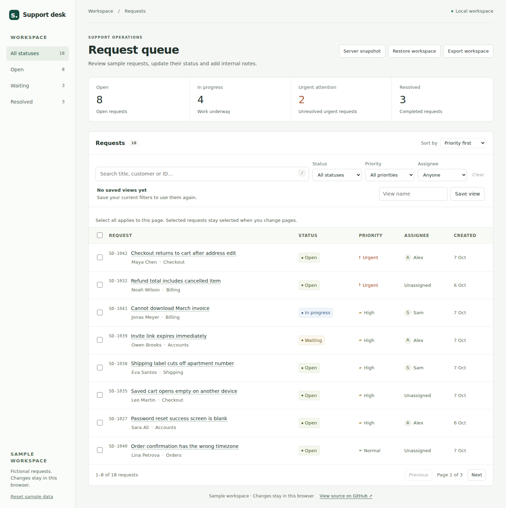
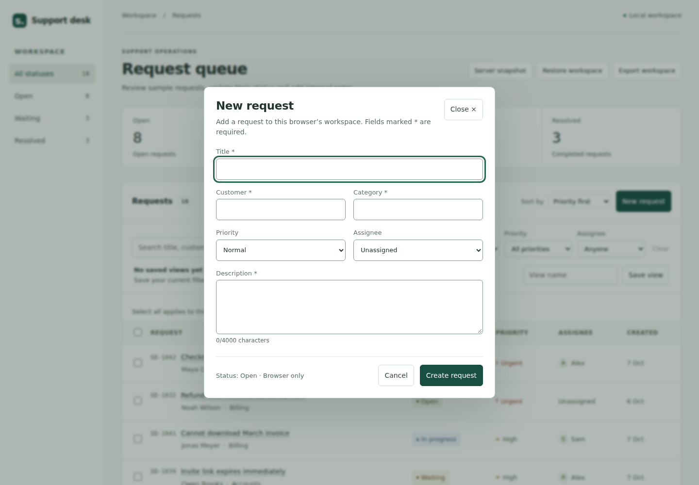
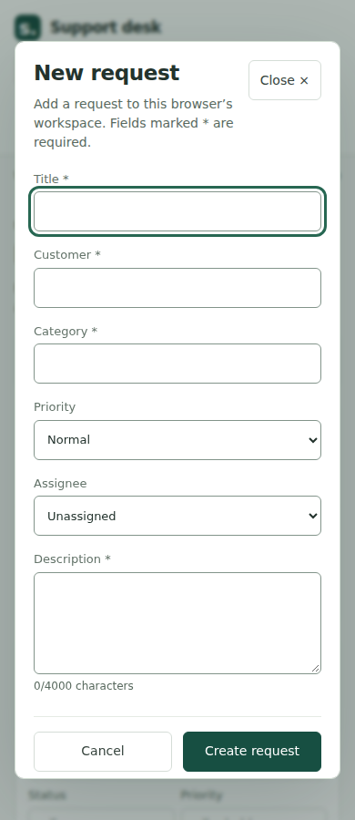

# Create request — QA and review

Date: 16 October 2026. Base: main `82614209f1d50933fe938ee871b41e488f1f1f8d` (tree `4c92e2835805b48adcc12f3868528015c0bcbd40`).

## Recommendation

**READY for owner review, conditional on green GitHub Checks for the final PR head.** No merge or public deployment was performed. This is a bounded feature, not an architecture migration.

## Verified evidence

| Check                                                | Status                     | Evidence                                                                                                                                                                                                            |
| ---------------------------------------------------- | -------------------------- | ------------------------------------------------------------------------------------------------------------------------------------------------------------------------------------------------------------------- |
| TypeScript strict, browser and server configurations | VERIFIED                   | `npm run build`                                                                                                                                                                                                     |
| ESLint and formatting                                | VERIFIED                   | `npm run lint`, `npm run format:check`                                                                                                                                                                              |
| Existing and new unit/integration tests              | VERIFIED                   | 48 tests, including 7 creation-domain tests and a creation/SQLite/revision round trip                                                                                                                               |
| Existing browser regression suite                    | VERIFIED                   | `tests/browser-smoke.mjs` against the actual production build                                                                                                                                                       |
| Creation browser suite                               | VERIFIED                   | 8 scenario groups in `tests/create-request.browser.mjs`; [results](create-request/browser-results.json)                                                                                                             |
| Independent production review pass                   | VERIFIED                   | Separate black-box assertions in `tests/create-request-review.mjs`; [results](create-request/review-results.json)                                                                                                   |
| Empty/whitespace fields, enum and length boundaries  | VERIFIED                   | Domain tests and browser invalid/first-error focus checks                                                                                                                                                           |
| ID collision                                         | VERIFIED                   | Domain collision and browser stubbed UUID; original record/copy unchanged                                                                                                                                           |
| 499 → 500 and rejection of request 501               | VERIFIED                   | Domain boundary and browser capacity error                                                                                                                                                                          |
| 2 MB UTF-8 limit                                     | VERIFIED                   | Domain multibyte growth and browser rejection with all description text retained                                                                                                                                    |
| Persistence, quota failure and retry                 | VERIFIED                   | Reload retains creation/history; failed write changes neither saved copy nor queue; retry inserts once                                                                                                              |
| Two tabs and storage-event timing                    | VERIFIED                   | Peer copy protected, stale draft retained; immediate read-check also catches a change without a delivered event                                                                                                     |
| API revision conflict and SQLite restart             | VERIFIED                   | Existing PUT snapshot route accepts creation; old ETag returns 412, duplicate document returns 400; revision/data survive restart                                                                                   |
| Public/static-host behavior                          | VERIFIED                   | Production assets served under a non-loopback test origin; creation + reload make zero API requests                                                                                                                 |
| Desktop/mobile layout                                | VERIFIED                   | 320, 390, 639, 640, 768, 1024, 1440 px; dialog/page horizontal overflow absent; new controls at least 44 px high                                                                                                    |
| Keyboard and focus                                   | VERIFIED                   | Initial title focus, Tab/Shift+Tab containment, first invalid focus, Enter/newline, Escape, cancel/reopen, success heading and return focus                                                                         |
| Accessibility scan                                   | VERIFIED within scan scope | Five default/invalid/success desktop/mobile axe scans, no violations. Some native-control contrast checks marked incomplete by axe; separate computed-color checks verify text >=4.5:1 and control boundaries >=3:1 |
| Existing CSS cascade                                 | VERIFIED                   | Computed typography/colors/padding/borders for 8 unchanged interface selectors equal the separately built base revision                                                                                             |
| Literal hostile text                                 | VERIFIED                   | HTML-like title remains text, no injected image or handler execution                                                                                                                                                |
| Corrupt-data recovery                                | VERIFIED                   | Creation works from the existing sample fallback; resulting saved snapshot is valid and reloadable                                                                                                                  |

The additional review pass uses the interface and production assets rather than asserting React state or Tailwind class strings. It was performed as a separate adversarial review by the implementation agent; it is **not an external human review**. Automated checks are supplemented by visual inspection of actual desktop/mobile captures.

## Regressions exercised

The unchanged browser smoke suite covers URL filters and sort, pagination, cross-page selection/bulk updates, ticket editing, notes/history, focus when an edited ticket leaves the filter, saved-view creation/apply/reload/duplicates/removal/two-tab and corrupt-storage behavior, JSON export/import/file restore, reset, long imported names, an assignee named All, large histories, size-rejected edits, local server snapshot refresh/save/load, stale revisions, unavailable Vite API and static-host controls. Creation tests additionally round-trip a created record, preserve a saved view and explain a filtered-out new request.

## Findings corrected during review

1. Initial browser focus selected Close instead of Title; title is now focused after showModal.
2. Inline errors were changing the input's accessible name; each field now has a stable labelled-by span and a separately described error.
3. Native Tab boundary behavior was inconsistent with the intended contained sequence; explicit boundary wrapping covers both form and success states.
4. Tailwind rem sizing would shrink controls in this 14 px-root application; intentional pixel values retain 44 px targets and existing spacing.
5. Existing low-contrast input borders were unsuitable for the new controls; a scoped >=3:1 boundary was added without resetting the rest of the app.

A failing draft test compared JSON string key order after canonical import, and a focus test selected a hidden saved-views dialog instead of the open dialog. These test defects were corrected; they are not represented as product fixes.

## Limitations and remaining verification

| Item                                                         | Status                                | Practical implication                                                                                                                                                  |
| ------------------------------------------------------------ | ------------------------------------- | ---------------------------------------------------------------------------------------------------------------------------------------------------------------------- |
| Real Figma file/handoff                                      | UNVERIFIED / unavailable              | [Exact design specification](create-request-design.md) and screenshots are provided; no Figma experience is claimed                                                    |
| Safari, Firefox, physical mobile browsers, virtual keyboard  | UNVERIFIED                            | Local browser verification uses Chromium 153; CI uses Playwright's installed Chromium                                                                                  |
| NVDA/VoiceOver or another human screen-reader session        | UNVERIFIED                            | Semantics, linked errors, focus and axe checked; no certified accessibility claim                                                                                      |
| Browser quota/private mode/power loss                        | ENVIRONMENT DEPENDENT                 | Quota failures are simulated; storage durability and limits remain browser-specific                                                                                    |
| Truly simultaneous multi-tab writes between read and setItem | ENVIRONMENT DEPENDENT                 | Existing localStorage optimistic guard is retained; it is not a transactional cross-tab compare-and-swap. Local API ETags/SQLite provide transactional revision checks |
| GitHub Actions on final head                                 | ENVIRONMENT DEPENDENT until completed | Consult the PR Checks tab; local results do not substitute for a successful remote run                                                                                 |
| Next.js example                                              | NOT STARTED                           | Requires a separate scenario and approval                                                                                                                              |

No unresolved FAILED product check is being hidden. UNVERIFIED items above remain outside the demonstrated scope; do not describe this as “ALL PASSED.”

## Architecture decisions

- `appendRequest` is a pure typed domain operation. It trims user input, appends a history event, checks collisions and validates the candidate using the existing import/export schema. The original records are not mutated.
- Existing `setTickets` gains an opt-in persistence requirement. Creation checks the latest saved string and writes before committing React state, so failure keeps the form and queue unchanged. Existing edit/import in-tab fallback behavior is preserved.
- UUID-based IDs avoid depending on numeric seed IDs or imported ID formats. A detected collision rejects the operation rather than overwriting data.
- A synchronous local write needs neither an invented network request nor a spinner. The optional server still receives the full snapshot only when the user explicitly saves it through Server snapshot, with the existing ETag contract.
- Native dialog and small local form state keep this feature independent of authentication, global state libraries or new routing. Tailwind is confined to the new flow.

## Technologies honestly demonstrated

React component/state/event handling; strict TypeScript domain types; Tailwind/Vite integration and cascade control; responsive forms; native dialog focus behavior; accessible labels/validation; localStorage failure handling; Playwright and axe browser checks; Node/SQLite snapshot integration and optimistic revisions; GitHub CI configuration. **Not demonstrated by this change:** Figma handoff, Next.js, Redux, commercial experience, production authentication or cloud server persistence.

## Interview questions

1. Why does creation require persistence before updating React state, while existing edits allow an in-tab fallback?
2. How do validation, duplicate IDs and UTF-8 snapshot limits differ, and why validate the entire candidate snapshot?
3. Why omit Tailwind Preflight and use prefixed utilities? How do CSS layers and selector specificity affect legacy styles?
4. What should happen when the created ticket is hidden by current filters or appears on another page?
5. What protection does localStorage's optimistic guard provide, and how is it weaker than ETag/SQLite revision checking?

